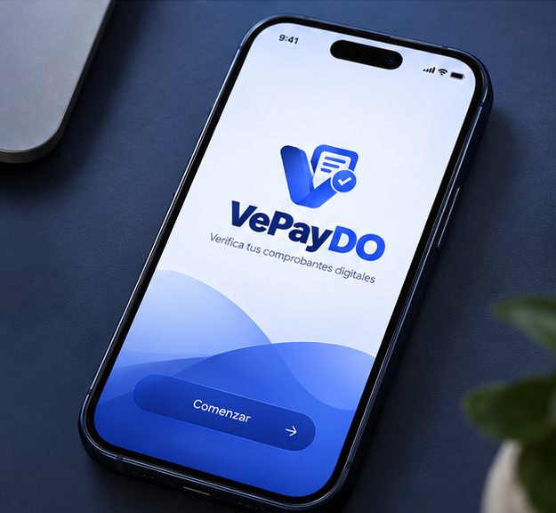

# VePayDO API - Backend App (.NET 10)

[](https://github.com/luismanuelcldev/vepaydo-api/actions/workflows/ci.yml)
[](https://github.com/luismanuelcldev/vepaydo-api/actions/workflows/codeql.yml)
[](SECURITY.md)

High-performance, multi-tenant enterprise backend built with **.NET 10**, **C# 13**, **ASP.NET Core**, and **PostgreSQL with Row-Level Security (RLS)**.



---

## Architectural Overview & Design Principles

The application is structured following **Clean & Hexagonal Architecture (Ports & Adapters)** principles, ensuring strict boundary decoupling between business rules, application orchestration, presentation endpoints, and external infrastructure dependencies.

---

## Engineering Highlights & Design Decisions

### 1. Micro-Modular Source File Standard (<= 100 Lines / File)
Every single C# source file across both production and test suites strictly adheres to a **maximum threshold of 100 lines of code**.
- **High Cohesion & Single Responsibility:** Prevents bloated god-classes, separating operational workflows (e.g., authentication login, refresh, registration, session management) into clean `partial class` modules.
- **Fast Pull Requests & Zero Merge-Conflict Friction:** Enables clean Git diffs, effortless code reviews, and streamlined branch merges.

### 2. Multi-Tenancy via Native PostgreSQL Row-Level Security (RLS)
Rather than relying solely on application-level filtering (such as EF Core global query filters, which can be bypassed by raw SQL or un-filtered queries), data isolation is enforced directly at the database engine level:
- Every tenant transaction executes through `ITenantTransactionRunner`, setting tenant context parameters on the active database connection.
- PostgreSQL Row-Level Security policies guarantee that zero cross-tenant leakage is physically possible, regardless of application bugs or query complexity.

### 3. Enterprise Security & Cryptographic Invariants
- **Argon2id Password Hashing:** Industry-standard memory-hard hashing resistant to GPU/ASIC attacks.
- **Stateless JWT with Instant Session Revocation:** Access tokens carry a cryptographic session identifier validated against an in-memory / Redis revocation store on every request, allowing immediate global or individual session termination.
- **Cross-Origin & Account Gating:** Strict origin checking middleware alongside gate policies enforcing terms acceptance and forced password resets before allowing access to domain endpoints.

### 4. Idempotency & Concurrency Safety
- Key write operations (such as receipt uploads and billing charges) enforce an `Idempotency-Key` header (UUIDv5 derived), ensuring deterministic replay and preventing double submissions across network retries.

### 5. Observability & Sensitive Data Redaction
- Integrated **Serilog** logging pipeline equipped with custom `RedactingDestructuringPolicy` destructuring policies that automatically mask and sanitize credentials, tokens, PII, and financial identifiers before emitting log events.
- Standardized **RFC 9457 Problem Details** exception handling guaranteeing machine-readable errors without leaking internal stack traces or database structures.

---

## Repository Structure

```text
src/
├── VepayDO.Domain/              # Pure domain models, value objects, domain exceptions & invariants
├── VepayDO.Contracts/           # Public wire DTOs and request/response contracts
├── VepayDO.Application/         # Core business use cases, services, port interfaces & validation
├── VepayDO.Infrastructure/      # Persistence (Postgres/EF Core), S3 storage, Redis & security adapters
├── VepayDO.Worker/              # Background service consumer for asynchronous processing jobs
└── VepayDO.Api/                 # ASP.NET Core Web API, HTTP middleware pipeline, filters & controllers

tests/
├── VepayDO.Architecture.Tests/  # Architectural boundary validation (NetArchTest / rules enforcement)
├── VepayDO.Domain.Tests/        # Unit tests covering pure domain logic, calculations & value objects
├── VepayDO.Application.Tests/   # Application use case unit tests with deterministic service fakes
├── VepayDO.Infrastructure.Tests/# Integration tests with real PostgreSQL schemas and RLS policies
└── VepayDO.Api.Tests/           # HTTP pipeline integration test suites using WebApplicationFactory
```

---

## Testing Strategy

The repository follows a rigorous automated testing pyramid:

| Test Suite | Purpose | Execution |
| :--- | :--- | :--- |
| **Architecture Tests** | Enforces clean architecture rules and prevents forbidden cross-layer references. | In-Memory (Fast) |
| **Domain Tests** | Validates monetary math, value objects, error mapping, and invariants. | In-Memory (Fast) |
| **Application Tests** | Exercises application use cases with isolation via interface fakes. | In-Memory (Fast) |
| **API Endpoints Tests** | Validates full HTTP pipeline, route conventions, rate limits, and problem-details errors. | WebApplicationFactory |
| **Infrastructure Tests** | Verifies database migrations, EF Core mappings, and PostgreSQL RLS tenant isolation. | Live PostgreSQL Host |

---

## Build & Run Instructions

### Prerequisites
- **.NET 10 SDK** (v10.0+)
- **Docker** or a running **PostgreSQL 16+** instance (optional for unit and API tests)

### Compilation
```bash
# Build entire solution with zero warnings and zero errors
dotnet build -c Release
```

### Running Test Suites
```bash
# Run Domain, Architecture, Application and API suites
dotnet test tests/VepayDO.Domain.Tests
dotnet test tests/VepayDO.Architecture.Tests
dotnet test tests/VepayDO.Application.Tests
dotnet test tests/VepayDO.Api.Tests
```

---

## License & Intellectual Property

> **Copyright (c) 2026 Luis Manuel De La Cruz Ledesma. All rights reserved.**
>
> This source code is made available **exclusively for evaluation purposes**. Copying, modification, redistribution, or commercial use without authorization is strictly prohibited. See [LICENSE](LICENSE) for details.
